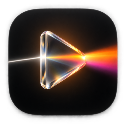
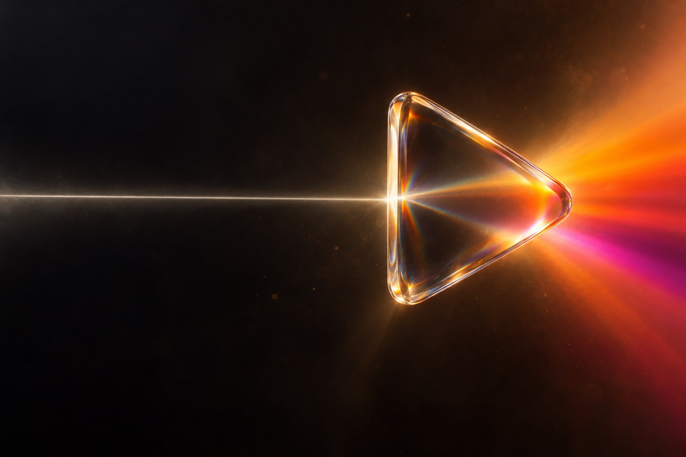
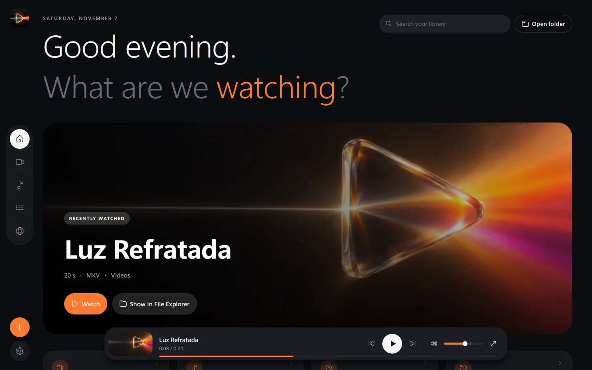
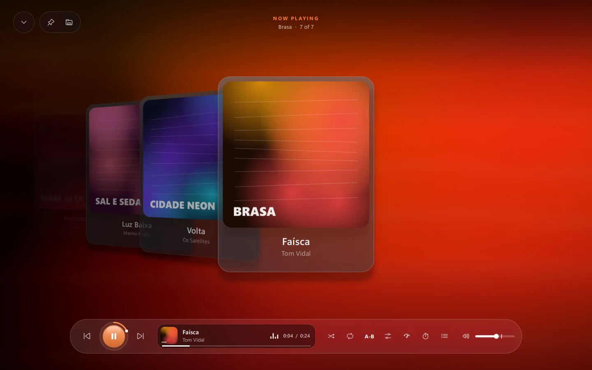
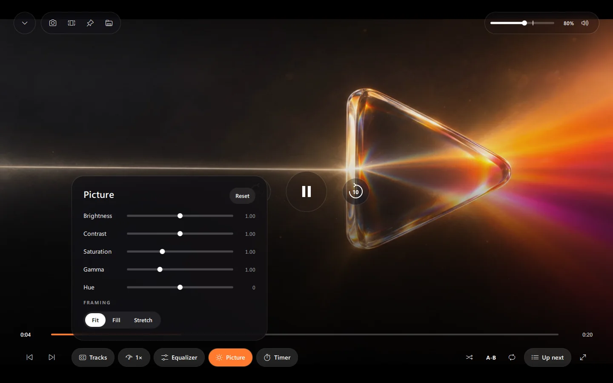
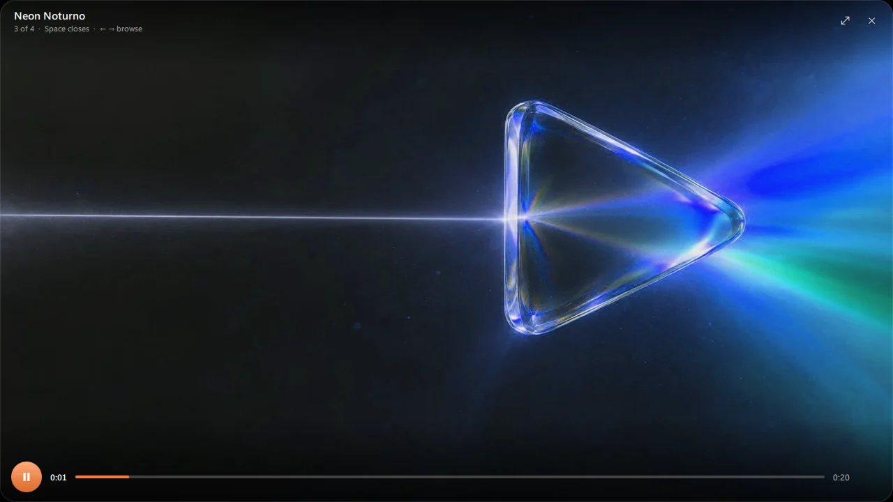

<div align="center">



# Refrata

**A video and music player for Windows and Linux, built on the VLC engine, with true HDR.**

Every codec, format and protocol VLC plays, in an interface designed from scratch, with HDR at its
real brightness, smooth motion and subtitles written by AI on your own computer.

[](https://github.com/LucsLabsStudios/refrata/releases/latest)
[](https://github.com/LucsLabsStudios/refrata/actions/workflows/build.yml)
[](https://github.com/LucsLabsStudios/refrata/actions/workflows/linux.yml)
[](LICENSE)

[**Download**](https://refrata.vercel.app) · [Releases](https://github.com/LucsLabsStudios/refrata/releases) · [Changelog](CHANGELOG.md) · [Report a bug](https://github.com/LucsLabsStudios/refrata/issues/new/choose) · [Português](README.pt-BR.md)

</div>



## Why Refrata

VLC plays everything. Refrata keeps that engine, shows each video the way it was mastered, and
wraps it in the experience people expect from a player today.

- **Plays anything VLC plays.** libVLC 3 and all of its modules ship inside the app, so nothing
  else needs to be installed.
- **Shows the picture as it was made.** HDR10, HDR10+ and HLG with correct color, true HDR output
  on Windows HDR screens, smooth motion at the monitor's refresh rate and native resolution up to
  8K, all on the GPU.
- **Writes the subtitles a video lacks.** Speech recognition with Whisper runs on your graphics
  card, offline, and can translate into English.
- **Feels like a modern app.** Large type, real-time frosted glass over the video, light and dark
  themes, and motion that respects the system's reduced-motion setting.
- **Opens instantly.** Single instance, a fast hand-off from Explorer, and a QuickLook-style
  preview when you press Space on a file.
- **Updates itself, safely.** In-app updates check both a SHA-256 checksum and an Ed25519
  signature from the project key before anything installs.
- **Speaks your language.** 14 interface languages, switched live.
- **Tested like a product.** Every release passes unit tests, an end-to-end suite that clicks
  through the interface, over 100 robustness scenarios (4K60 frame pacing among them), a check that
  each of the 224 interface controls is used by a test, and clean installs on Ubuntu and Debian.

## New in 2.0

| | |
|---|---|
| **True HDR** | With Windows HDR on, HDR video shows at its real brightness up to the screen's peak, while the interface stays at the desktop's SDR brightness. On an SDR screen, HDR is tone mapped with the BT.2390 curve. |
| **HDR10+ and per-frame brightness** | HDR10+ (SMPTE ST 2094-40) metadata is followed scene by scene; plain HDR10 is measured on the GPU every frame, so dark scenes are not dimmed. |
| **Smooth motion** | 24 and 30 fps video plays at 60, 120 fps or the monitor's refresh rate. Motion is searched to a quarter of a pixel; logos and subtitles stay still; scene cuts show the real frame. |
| **NVIDIA RTX Video** | Super Resolution and RTX Video HDR through the GPU's video processor on RTX cards. |
| **AI subtitles** | whisper.cpp built into the app, running on the GPU through Vulkan. The model (82 MB, or 574 MB on GPUs with 3 GB or more) downloads once and is checked by SHA-256. |
| **Player tools** | A second subtitle at the top of the picture, one frame back, bookmarks on the timeline, skip intro and credits per folder, A-B clips to MP4 or GIF, Dolby, DTS, TrueHD and Atmos passthrough. |
| **Native frame path** | Frames go from libVLC to Qt in Rust and C++, without Python; in the release tests, 4K60 SDR and HDR10+ play at 60 fps with no dropped frames. |

True HDR output, RTX Video and AI subtitles are Windows-only for now. The full list is in the
[changelog](CHANGELOG.md).

<table>
  <tr>
    <td></td>
    <td></td>
  </tr>
  <tr>
    <td></td>
    <td></td>
  </tr>
</table>

## Download

| Platform | Package | Notes |
|---|---|---|
| Windows 10/11 (x64) | `Refrata-Setup-<version>.exe` | Per-user install, no administrator rights needed. Adds Refrata to **Open with** and **Default apps** for 41 file types without taking over another player's defaults. Updates itself. |
| Windows 10/11 (x64) | `Refrata-<version>-portable.zip` | Unzip and run `Refrata.exe`. Leaves Windows untouched; **Settings › Quick open › Make default** registers it on demand. |
| Ubuntu 24.04, Debian 13, Linux Mint 22+ | `refrata_<version>_amd64.deb` | `sudo apt install ./refrata_<version>_amd64.deb`. Uses the distribution's VLC, integrates with the app menu, **Open with** and MPRIS media controls. |
| Linux (x86-64) | `Refrata-<version>-linux-x86_64.tar.gz` | Extract and run. |

Get them from **[refrata.vercel.app](https://refrata.vercel.app)** or the
[latest release](https://github.com/LucsLabsStudios/refrata/releases/latest). Each file is
published with its `.sha256` checksum and `.sig` signature.

> [!NOTE]
> Windows builds are not code-signed yet, so SmartScreen may warn on first launch. Choose
> **More info › Run anyway**. See the [code signing policy](#code-signing-policy).

## Features

| Area | What you get |
|---|---|
| **Video** | Native resolution up to 8K with GPU color conversion, hardware decoding, brightness/contrast/saturation/gamma/hue, light and detail boost, fit/fill/stretch, rotate, mirror, forced aspect, zoom, deinterlacing, timeline scene preview |
| **HDR** | HDR10, HDR10+ and HLG with correct color (BT.2390 tone curve, BT.2020 gamut mapping); HDR10+ metadata followed scene by scene and HDR10 brightness measured per frame on the GPU; true HDR output on Windows HDR screens (scRGB), with the interface at the desktop's SDR brightness |
| **Smooth motion** | GPU frame interpolation to 60 or 120 fps or the monitor's refresh rate: quarter-pixel motion search, per-pixel vector choice that keeps logos and subtitles still, scene-cut and occlusion fallback, no resolution limit |
| **NVIDIA RTX** | RTX Video Super Resolution and RTX Video HDR through the GPU's video processor (RTX cards) |
| **Audio** | Volume up to 150%, 10-band equalizer with preamp and 18 presets, volume normalization, output device selection (speakers, headphones, HDMI), passthrough of Dolby and DTS (and TrueHD, DTS-HD, Atmos in HD mode) to a receiver |
| **Subtitles** | Track switching, external files (button or drag and drop), delay, OpenSubtitles search by file hash, size/color/background, encoding selection, a second subtitle at the top of the picture (SRT, WebVTT, ASS), subtitles from speech with Whisper on the GPU, optionally translated into English, all offline |
| **Playback** | Queue with reorder and play next, shuffle and repeat, speed 0.25×–4×, A-B repeat, frame stepping forwards and backwards, chapters, bookmarks on the timeline, skip intro and credits per folder, resume where you left off, sleep timer, snapshots, save the A-B part as MP4 (stream copy, HDR kept) or GIF |
| **Library** | Scans your video and music folders, thumbnails, durations and tags, search and sort |
| **Network** | YouTube, Vimeo and other sites through yt-dlp, HTTP/HLS/RTSP/RTMP/SMB streams, Chromecast casting |
| **Windows** | Space-bar preview in Explorer and on the desktop, quick player, tray mode and start with Windows, picture-in-picture, always on top, keyboard media keys and the Windows media overlay |
| **Linux** | `.deb` and `.tar.gz` packages, MPRIS media keys and desktop media widgets, **Open with**, start with the session |
| **Playlists** | M3U/M3U8, PLS, XSPF |
| **Languages** | English, Portuguese, Spanish, French, German, Italian, Russian, Polish, Turkish, Indonesian, Hindi, Simplified Chinese, Japanese, Korean |

<details>
<summary><b>Keyboard shortcuts</b></summary>

| Key | Action | Key | Action |
|---|---|---|---|
| `Space` | Play / pause | `F` / `F11` | Full screen |
| `←` `→` | Back / forward 10 s | `↑` `↓` | Volume |
| `M` | Mute | `N` / `P` | Next / previous |
| `Shift+N` / `Shift+P` | Next / previous chapter | `[` `]` `=` | Slower / faster / normal speed |
| `S` | Snapshot | `E` / `Shift+E` | Next / previous frame |
| `B` | Bookmark this moment | | |
| `L` | A-B repeat | `T` | Always on top |
| `I` | Media information | `R` | Rotate |
| `Ctrl+P` | Picture-in-picture | `Ctrl+O` | Open files |
| `Ctrl+L` | Network streams | `Esc` | Exit full screen / close |

Every shortcut except `Esc` and `F11` can be changed in **Settings › Keyboard shortcuts**.
</details>

## Build from source

Requires Python 3.12. libVLC is found in this order: bundled with the app, `vendor/vlc` (filled
by the build), then a system VLC 3 install.

```powershell
git clone https://github.com/LucsLabsStudios/refrata.git
cd refrata
pip install -r requirements.txt -r requirements-dev.txt

python src/refrata/__main__.py                  # run the app
python src/refrata/__main__.py "C:\film.mkv"    # open files, folders, playlists or URLs
python tests/unit.py                            # unit tests (seconds)
python tests/e2e.py                             # end-to-end suite (about 5 minutes)
python tools/build.py                           # app folder, portable zip, installer
```

`pip install -e .` also works and adds a `refrata` command. Packaging, releases, signing and the
complete test matrix are covered in the [development guide](docs/development.md).

## Project structure

```
refrata/
├── src/refrata/          Application package
│   ├── __main__.py       Entry point: startup, single instance, --selftest
│   ├── engine.py         Playback on libVLC: queue, tracks, EQ, chapters, casting, video frames to Qt
│   ├── library.py        Folder scanning, filterable models, thumbnails
│   ├── updater.py        Signed in-app updates from GitHub Releases
│   ├── …                 Platform integration, settings, i18n, subtitles, yt-dlp
│   ├── ui/               The whole interface in Qt Quick (QML)
│   ├── resources/        Icons, fonts and brand images used at runtime
│   └── locales/          Translations, one JSON file per language
├── tests/                Unit, end-to-end, robustness, launch and packaging tests
├── tools/                Build, release, signing, localization and brand tooling
├── packaging/windows/    Inno Setup installer and MSIX (Microsoft Store) package
├── native/               Rust and C++ module: frame delivery to Qt, RTX Video, HDR10+, whisper.cpp
├── site/                 refrata.vercel.app
└── docs/                 Guides and design notes
```

## Documentation

| Guide | Contents |
|---|---|
| [Development guide](docs/development.md) | Running from source, tests, packaging, releases, update signing |
| [Architecture](docs/architecture.md) | How the app is put together and why |
| [Code signing](docs/code-signing.md) | Signing setup and the SignPath application (Portuguese) |
| [Microsoft Store](docs/microsoft-store.md) | MSIX packaging and Store submission (Portuguese) |
| [Brand](docs/brand.md) | Identity, palette and asset generation (Portuguese) |
| [Performance roadmap](docs/roadmap-performance-and-platforms.md) | Measurements, Rust and other platforms (Portuguese) |

## Security

Updates are accepted only when signed with the project's Ed25519 key, so even a compromised GitHub
account could not push an installer to existing users. To report a vulnerability, see
[SECURITY.md](SECURITY.md).

## Contributing

Refrata is open source but does not accept pull requests: every update reaches all installed
copies automatically, so all code in this repository is written by the maintainer. Bug reports,
ideas and questions are very welcome in [Issues](https://github.com/LucsLabsStudios/refrata/issues),
and forks are welcome under the GPL. See [CONTRIBUTING.md](CONTRIBUTING.md).

## Code signing policy

Releases are not code-signed yet (the SignPath Foundation program asks for more public adoption
first; the project will reapply). Every release ships its SHA-256, which the in-app updater also
verifies before installing.

- Committers and reviewers: [LucsLabsStudios](https://github.com/LucsLabsStudios)
- Approvers: [LucsLabsStudios](https://github.com/LucsLabsStudios)

Signed binaries are built only by the public GitHub Actions workflow in this repository
([`.github/workflows/build.yml`](.github/workflows/build.yml)), and every signing request is
approved by hand.

**Privacy:** this program will not transfer any information to other networked systems unless
specifically requested by the user or the person installing or operating it. The optional update
check only reads the public GitHub releases of this repository and can be turned off in
**Settings › Updates**.

## License

Refrata © LucsLabs Studios is free software under the [GNU GPL 3.0](LICENSE). It bundles libVLC
and the VLC 3 modules (VideoLAN, LGPL 2.1+ / GPL 2+) and Qt for Python (LGPL 3), redistributed
unmodified; see [`packaging/windows/installer/LICENSE-pt.txt`](packaging/windows/installer/LICENSE-pt.txt).
"VLC" is a trademark of VideoLAN. Refrata is an independent project and is not affiliated with
VideoLAN.
