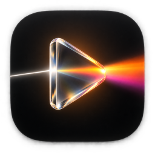
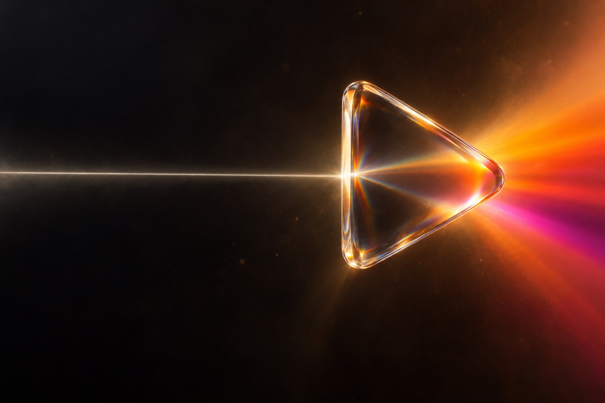
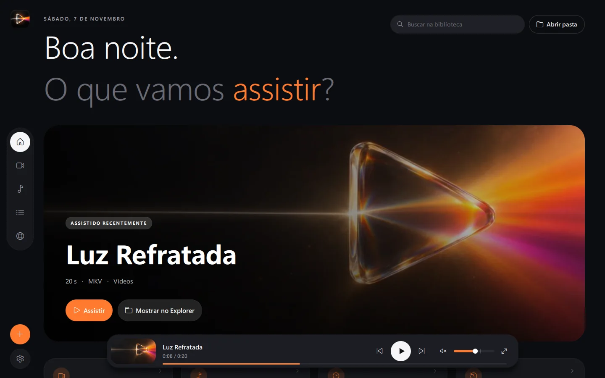

<div align="center">



# Refrata

**Um player de vídeo e música para Windows e Linux, sobre o motor do VLC, com HDR de verdade.**

Todos os codecs, formatos e protocolos que o VLC toca, numa interface desenhada do zero, com HDR no
brilho real, movimento suave e legendas escritas por IA no seu próprio computador.

[](https://github.com/LucsLabsStudios/refrata/releases/latest)
[](https://github.com/LucsLabsStudios/refrata/actions/workflows/build.yml)
[](https://github.com/LucsLabsStudios/refrata/actions/workflows/linux.yml)
[](LICENSE)

[**Baixar**](https://refrata.vercel.app) · [Lançamentos](https://github.com/LucsLabsStudios/refrata/releases) · [Histórico de mudanças](CHANGELOG.md) · [Relatar um bug](https://github.com/LucsLabsStudios/refrata/issues/new/choose) · [English](README.md)

</div>



## Por que o Refrata

O VLC toca tudo. O Refrata mantém esse motor, mostra cada vídeo como ele foi masterizado e entrega
a experiência que se espera de um player hoje.

- **Toca tudo o que o VLC toca.** O libVLC 3 e todos os módulos vêm dentro do app; não é preciso
  instalar mais nada.
- **Mostra a imagem como ela foi feita.** HDR10, HDR10+ e HLG com as cores certas, saída HDR real em
  telas com o HDR do Windows ligado, movimento suave na taxa do monitor e resolução nativa até 8K,
  tudo na placa de vídeo.
- **Escreve a legenda que falta.** O reconhecimento de fala do Whisper roda na sua placa de vídeo,
  sem internet, e pode traduzir para o inglês.
- **Parece um app de hoje.** Tipografia grande, vidro fosco com desfoque em tempo real sobre o
  vídeo, temas claro e escuro, e animações que respeitam a opção do sistema de reduzir movimento.
- **Abre na hora.** Uma janela só, entrega rápida de arquivos vindos do Explorer e prévia no estilo
  QuickLook ao apertar Espaço num arquivo.
- **Atualiza sozinho, com segurança.** A atualização dentro do app confere o SHA-256 e uma
  assinatura Ed25519 da chave do projeto antes de instalar qualquer coisa.
- **Fala o seu idioma.** 14 idiomas, trocados na hora.
- **Testado como produto.** Todo lançamento passa por testes de unidade, uma bateria de ponta a
  ponta que clica pela interface, mais de 100 cenários de robustez (entre eles o ritmo de quadros em
  4K60), uma conferência de que cada um dos 224 controles da interface é usado por algum teste, e
  instalações limpas no Ubuntu e no Debian.

## Novidades da 2.0

| | |
|---|---|
| **HDR de verdade** | Com o HDR do Windows ligado, o vídeo HDR aparece com o brilho real, até o pico da tela, e a interface fica no brilho SDR da área de trabalho. Numa tela SDR, o HDR é convertido com a curva BT.2390. |
| **HDR10+ e brilho por quadro** | Os metadados HDR10+ (SMPTE ST 2094-40) são seguidos cena por cena; o HDR10 comum é medido na GPU a cada quadro, e cena escura não fica apagada. |
| **Movimento suave** | Vídeo de 24 e 30 fps passa a 60, 120 fps ou na taxa do monitor. O movimento é buscado com precisão de ¼ de pixel; logotipos e legendas ficam parados; cortes de cena mostram o quadro real. |
| **NVIDIA RTX Video** | Super Resolution e RTX Video HDR pelo processador de vídeo da GPU, em placas RTX. |
| **Legendas por IA** | whisper.cpp dentro do app, rodando na GPU pelo Vulkan. O modelo (82 MB, ou 574 MB em placas com 3 GB ou mais) é baixado uma vez e conferido por SHA-256. |
| **Ferramentas do player** | Segunda legenda no alto da imagem, voltar um quadro, favoritos na barra de tempo, pular abertura e encerramento por pasta, trecho A-B em MP4 ou GIF, passthrough de Dolby, DTS, TrueHD e Atmos. |
| **Caminho nativo dos quadros** | Os quadros vão do libVLC ao Qt em Rust e C++, sem passar pelo Python; nos testes de lançamento, 4K60 em SDR e HDR10+ roda a 60 fps sem quadros descartados. |

A saída HDR real, o RTX Video e as legendas por IA são, por enquanto, só do Windows. A lista
completa está no [histórico de mudanças](CHANGELOG.md).

<table>
  <tr>
    <td></td>
    <td></td>
  </tr>
  <tr>
    <td></td>
    <td></td>
  </tr>
</table>

## Baixar

| Sistema | Pacote | Observações |
|---|---|---|
| Windows 10/11 (x64) | `Refrata-Setup-<versão>.exe` | Instalação por usuário, sem pedir administrador. Coloca o Refrata em **Abrir com** e em **Apps padrão** para 41 tipos de arquivo, sem tomar o padrão de outro player. Atualiza sozinho. |
| Windows 10/11 (x64) | `Refrata-<versão>-portable.zip` | Descompacte e rode o `Refrata.exe`. Não mexe no Windows; **Ajustes › Abertura rápida › Tornar padrão** registra a cópia quando você quiser. |
| Ubuntu 24.04, Debian 13, Linux Mint 22+ | `refrata_<versão>_amd64.deb` | `sudo apt install ./refrata_<versão>_amd64.deb`. Usa o VLC da distribuição, aparece no menu de aplicativos e no **Abrir com**, e funciona com os controles de mídia (MPRIS). |
| Linux (x86-64) | `Refrata-<versão>-linux-x86_64.tar.gz` | Descompacte e rode. |

Baixe em **[refrata.vercel.app](https://refrata.vercel.app)** ou no
[último lançamento](https://github.com/LucsLabsStudios/refrata/releases/latest). Cada arquivo sai
com o seu `.sha256` e a sua assinatura `.sig`.

> [!NOTE]
> As versões para Windows ainda não têm assinatura digital, então o SmartScreen pode avisar na
> primeira vez. Clique em **Mais informações › Executar assim mesmo**. Veja a
> [política de assinatura](#política-de-assinatura-de-código).

## Funcionalidades

| Área | O que tem |
|---|---|
| **Vídeo** | Resolução nativa até 8K com conversão de cor na GPU, decodificação por hardware, brilho/contraste/saturação/gama/matiz, realce de luz e de detalhe, ajustar/preencher/esticar, girar, espelhar, proporção, zoom, desentrelaçar, prévia de cenas na barra de tempo |
| **HDR** | HDR10, HDR10+ e HLG com as cores certas (curva BT.2390, mapeamento de BT.2020); metadados HDR10+ seguidos cena a cena e brilho do HDR10 medido a cada quadro na GPU; saída HDR real em telas com o HDR do Windows ligado (scRGB), com a interface no brilho SDR da área de trabalho |
| **Movimento suave** | Interpolação de quadros na GPU para 60 ou 120 fps ou a taxa do monitor: busca de movimento com precisão de ¼ de pixel, vetor escolhido por pixel (logotipos e legendas não se arrastam), volta ao quadro real em cortes de cena e oclusões, sem limite de resolução |
| **NVIDIA RTX** | RTX Video Super Resolution e RTX Video HDR pelo processador de vídeo da GPU (placas RTX) |
| **Áudio** | Volume até 150%, equalizador de 10 bandas com pré-amp e 18 presets, normalizar volume, escolha da saída (alto-falantes, fone, HDMI), passthrough de Dolby e DTS (e TrueHD, DTS-HD, Atmos no modo HD) para o receiver |
| **Legendas** | Troca de faixa, arquivos externos (botão ou arrastar), atraso, busca no OpenSubtitles pelo hash do arquivo, tamanho/cor/fundo, codificação, segunda legenda no alto da imagem (SRT, WebVTT, ASS), legendas geradas da fala com o Whisper na GPU, com tradução opcional para o inglês, tudo sem internet |
| **Reprodução** | Fila com reordenar e tocar em seguida, aleatório e repetir, velocidade 0,25×–4×, repetir trecho (A-B), quadro a quadro para frente e para trás, capítulos, favoritos na barra de tempo, pular abertura e encerramento por pasta, continuar de onde parou, timer de sono, captura de quadro, salvar o trecho A-B em MP4 (sem recodificar, mantendo o HDR) ou GIF |
| **Biblioteca** | Varredura das pastas de vídeos e músicas, miniaturas, duração e tags, busca e ordenação |
| **Rede** | YouTube, Vimeo e outros sites pelo yt-dlp, streams HTTP/HLS/RTSP/RTMP/SMB, transmissão para Chromecast |
| **Windows** | Prévia com Espaço no Explorer e na área de trabalho, player rápido, bandeja e iniciar com o Windows, picture-in-picture, sempre no topo, teclas de mídia e painel de mídia do Windows |
| **Linux** | Pacotes `.deb` e `.tar.gz`, teclas e widgets de mídia (MPRIS), **Abrir com**, iniciar com a sessão |
| **Playlists** | M3U/M3U8, PLS, XSPF |
| **Idiomas** | Português, inglês, espanhol, francês, alemão, italiano, russo, polonês, turco, indonésio, hindi, chinês simplificado, japonês, coreano |

<details>
<summary><b>Atalhos de teclado</b></summary>

| Tecla | Ação | Tecla | Ação |
|---|---|---|---|
| `Espaço` | Tocar / pausar | `F` / `F11` | Tela cheia |
| `←` `→` | Voltar / avançar 10 s | `↑` `↓` | Volume |
| `M` | Mudo | `N` / `P` | Próximo / anterior |
| `Shift+N` / `Shift+P` | Próximo / anterior capítulo | `[` `]` `=` | Mais lento / mais rápido / normal |
| `S` | Captura de quadro | `E` / `Shift+E` | Próximo / quadro anterior |
| `B` | Favoritar este momento | | |
| `L` | Trecho A-B | `T` | Sempre no topo |
| `I` | Informações da mídia | `R` | Girar |
| `Ctrl+P` | Picture-in-picture | `Ctrl+O` | Abrir arquivos |
| `Ctrl+L` | Streams | `Esc` | Sair da tela cheia / fechar |

Todos, menos `Esc` e `F11`, podem ser trocados em **Ajustes › Atalhos de teclado**.
</details>

## Compilar a partir do código

Requer Python 3.12. O libVLC é procurado nesta ordem: embutido no app, `vendor/vlc` (criado pelo
build) e depois um VLC 3 instalado no sistema.

```powershell
git clone https://github.com/LucsLabsStudios/refrata.git
cd refrata
pip install -r requirements.txt -r requirements-dev.txt

python src/refrata/__main__.py                    # abre o app
python src/refrata/__main__.py "C:\filme.mkv"     # abre arquivos, pastas, playlists ou URLs
python tests/unit.py                              # testes de unidade (segundos)
python tests/e2e.py                               # bateria de ponta a ponta (uns 5 minutos)
python tools/build.py                             # pasta do app, zip portátil e instalador
```

`pip install -e .` também funciona e cria o comando `refrata`. Empacotamento, lançamentos,
assinatura e todos os testes estão no [guia de desenvolvimento](docs/development.md) (em inglês).

## Estrutura do projeto

```
refrata/
├── src/refrata/          Pacote do app
│   ├── __main__.py       Ponto de entrada: inicialização, instância única, --selftest
│   ├── engine.py         Reprodução no libVLC: fila, faixas, EQ, capítulos, transmissão, quadros para o Qt
│   ├── library.py        Varredura de pastas, modelos filtráveis, miniaturas
│   ├── updater.py        Atualizações assinadas pelo GitHub Releases
│   ├── …                 Integração com o sistema, ajustes, idiomas, legendas, yt-dlp
│   ├── ui/               Toda a interface em Qt Quick (QML)
│   ├── resources/        Ícones, fontes e imagens da marca usados pelo app
│   └── locales/          Traduções, um JSON por idioma
├── tests/                Testes de unidade, ponta a ponta, robustez, abertura e pacotes
├── tools/                Build, lançamento, assinatura, traduções e identidade visual
├── packaging/windows/    Instalador (Inno Setup) e pacote MSIX (Microsoft Store)
├── native/               Módulo em Rust e C++: entrega de quadros ao Qt, RTX Video, HDR10+, whisper.cpp
├── site/                 refrata.vercel.app
└── docs/                 Guias e notas de projeto
```

## Documentação

| Guia | Conteúdo |
|---|---|
| [Guia de desenvolvimento](docs/development.md) | Rodar pelo código, testes, empacotamento, lançamentos, assinatura das atualizações (em inglês) |
| [Arquitetura](docs/architecture.md) | Como o app é montado e por quê (em inglês) |
| [Assinatura de código](docs/code-signing.md) | Configuração da assinatura e o pedido à SignPath |
| [Microsoft Store](docs/microsoft-store.md) | Pacote MSIX e envio para a Store |
| [Identidade visual](docs/brand.md) | Conceito, paleta e geração dos assets |
| [Roteiro de desempenho](docs/roadmap-performance-and-platforms.md) | Medições, Rust e outros sistemas |

## Segurança

O app só aceita atualizações assinadas com a chave Ed25519 do projeto: nem alguém que tomasse a
conta do GitHub conseguiria mandar um instalador para quem já usa o Refrata. Para relatar uma
vulnerabilidade, veja o [SECURITY.md](SECURITY.md).

## Contribuições

O Refrata é código aberto, mas não aceita pull requests: cada atualização chega automaticamente a
todos os apps instalados, então todo o código deste repositório é escrito pelo mantenedor. Bugs,
ideias e dúvidas são muito bem-vindos nas [Issues](https://github.com/LucsLabsStudios/refrata/issues),
e forks são livres pela GPL. Detalhes no [CONTRIBUTING.md](CONTRIBUTING.md).

## Política de assinatura de código

Os lançamentos ainda não têm assinatura digital (o programa da SignPath Foundation pede mais
adoção pública antes; o projeto vai pedir de novo). Todo lançamento sai com o seu SHA-256, que o
atualizador do app também confere antes de instalar.

- Commits e revisão: [LucsLabsStudios](https://github.com/LucsLabsStudios)
- Aprovação: [LucsLabsStudios](https://github.com/LucsLabsStudios)

Binários assinados só são gerados pelo workflow público do GitHub Actions deste repositório
([`.github/workflows/build.yml`](.github/workflows/build.yml)), e cada pedido de assinatura é
aprovado à mão.

**Privacidade:** este programa não envia nenhuma informação a outros sistemas em rede, a não ser
quando pedido pelo usuário ou por quem o instala ou opera. A verificação opcional de atualizações
só lê os lançamentos públicos deste repositório no GitHub e pode ser desligada em
**Ajustes › Atualizações**.

## Licença

Refrata © LucsLabs Studios é software livre sob a [GNU GPL 3.0](LICENSE). Inclui o libVLC e os
módulos do VLC 3 (VideoLAN, LGPL 2.1+ / GPL 2+) e o Qt for Python (LGPL 3), redistribuídos sem
modificação; veja [`packaging/windows/installer/LICENSE-pt.txt`](packaging/windows/installer/LICENSE-pt.txt).
"VLC" é marca da VideoLAN. O Refrata é um projeto independente, sem vínculo com a VideoLAN.
